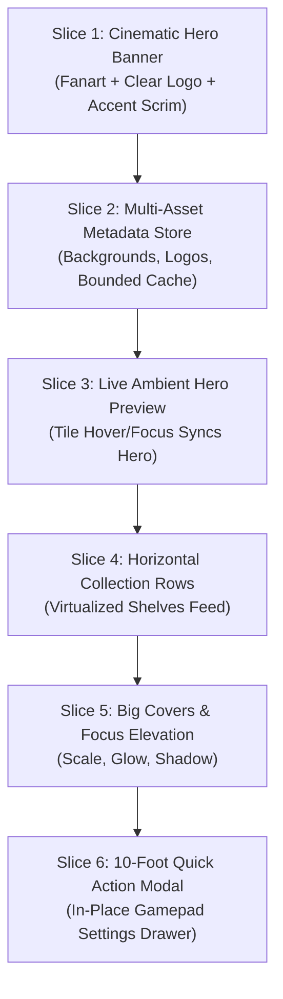

# PaRuX Gaming Frontend & UX Architecture Review
**Date:** 2026-11-22  
**Target:** WinUI 3 / C# Desktop & Console (10-Foot) Gaming Workspace  
**Subject:** Evolution towards a native Playnite Aniki–inspired Gaming Home  
**Author:** Frontend & UX Reviewer  

---

## Executive Summary & Context

PaRuX's Gaming workspace is built with WinUI 3 (Windows App SDK) and C#, adhering strictly to local-first architecture without cloud dependencies ([CLAUDE.md](file:///C:/Users/paolo/Desktop/PaRuX/.claude/worktrees/gemini-gaming-ux/CLAUDE.md#L3-L5)). The current implementation centers on a functional, data-dense catalogue interface: a top Continue shelf, a responsive hero banner, a side filter panel, and a virtualized grid or grouped view. 

The goal is to elevate this experience into an immersive, native Gaming Home inspired by the popular **Playnite Aniki theme** (characterised by a prominent cinematic hero with full-bleed fanart backdrops, transparent game clear logos, stacked horizontal collection shelves/rows, fluid focus transitions, big covers, fast filtering, and full 10-foot gamepad operation) while ensuring instant responsiveness across thousands of titles with list virtualization, asynchronous image pipelines, and strict memory bounds.

This review inspects existing code across [GamingHomeView.cs](file:///C:/Users/paolo/Desktop/PaRuX/.claude/worktrees/gemini-gaming-ux/src/PaRuX.App/Views/GamingHomeView.cs), [ManualGameLibraryView.cs](file:///C:/Users/paolo/Desktop/PaRuX/.claude/worktrees/gemini-gaming-ux/src/PaRuX.App/Views/ManualGameLibraryView.cs), [GroupedGameLibrary.cs](file:///C:/Users/paolo/Desktop/PaRuX/.claude/worktrees/gemini-gaming-ux/src/PaRuX.App/Views/GroupedGameLibrary.cs), [UniversalLibraryPanel.cs](file:///C:/Users/paolo/Desktop/PaRuX/.claude/worktrees/gemini-gaming-ux/src/PaRuX.App/Views/UniversalLibraryPanel.cs), and supporting visual components ([GameHeroCard.cs](file:///C:/Users/paolo/Desktop/PaRuX/.claude/worktrees/gemini-gaming-ux/src/PaRuX.App/Views/GameHeroCard.cs), [GameTileGrid.cs](file:///C:/Users/paolo/Desktop/PaRuX/.claude/worktrees/gemini-gaming-ux/src/PaRuX.App/Views/GameTileGrid.cs), [GameDetailPanel.cs](file:///C:/Users/paolo/Desktop/PaRuX/.claude/worktrees/gemini-gaming-ux/src/PaRuX.App/Views/GameDetailPanel.cs), [GameSideFilterPanel.cs](file:///C:/Users/paolo/Desktop/PaRuX/.claude/worktrees/gemini-gaming-ux/src/PaRuX.App/Views/GameSideFilterPanel.cs)). It catalogs current capabilities, identifies architectural and UX gaps, defines 6 discrete end-to-end implementation slices, and details accessibility and focus risks.

---

## 1. What Exists Today (Code & File:Line Evidence)

### 1.1 Root Shell & Workspace Navigation
- **Workspace Hosting & Section Tab Strip:**  
  [ManualGameLibraryView.cs](file:///C:/Users/paolo/Desktop/PaRuX/.claude/worktrees/gemini-gaming-ux/src/PaRuX.App/Views/ManualGameLibraryView.cs#L398-L451) organizes the Gaming space into five primary sections using a `SelectorBar` inside a horizontal `ScrollViewer`: `"Library"`, `"Downloads"`, `"Add"` (Add & import), `"Emulators"` (Emulators & ROMs), and `"Devices"` (Gaming settings).
  - The Library section exclusively hosts [UniversalLibraryPanel.cs](file:///C:/Users/paolo/Desktop/PaRuX/.claude/worktrees/gemini-gaming-ux/src/PaRuX.App/Views/UniversalLibraryPanel.cs#L24-L76), which in turn embeds [GamingHomeView.cs](file:///C:/Users/paolo/Desktop/PaRuX/.claude/worktrees/gemini-gaming-ux/src/PaRuX.App/Views/GamingHomeView.cs#L70-L75).
- **Active Gaming Banner & Mode Exit:**  
  In [ManualGameLibraryView.cs](file:///C:/Users/paolo/Desktop/PaRuX/.claude/worktrees/gemini-gaming-ux/src/PaRuX.App/Views/ManualGameLibraryView.cs#L468-L498), a persistent status strip `_gamingStrip` displays when a game is active (`_returnToAiAvailable`), providing a direct "Return to AI" button.
- **Dynamic Theming Support:**  
  [ManualGameLibraryView.cs](file:///C:/Users/paolo/Desktop/PaRuX/.claude/worktrees/gemini-gaming-ux/src/PaRuX.App/Views/ManualGameLibraryView.cs#L458-L466) integrates with `LibraryThemeState`, applying extension background colors when compatible with the active system theme.

### 1.2 Continue-Playing Hero Card
- **Hero Presentation & Composition:**  
  [GameHeroCard.cs](file:///C:/Users/paolo/Desktop/PaRuX/.claude/worktrees/gemini-gaming-ux/src/PaRuX.App/Views/GameHeroCard.cs#L22-L84) implements `GameHeroCard`. It hosts:
  - A portrait cover `_cover` (`Width = 144` desktop / `176` console, aspect 4:3, [GameHeroCard.cs](file:///C:/Users/paolo/Desktop/PaRuX/.claude/worktrees/gemini-gaming-ux/src/PaRuX.App/Views/GameHeroCard.cs#L112-L115)).
  - A backdrop `_backdrop` and gradient scrim `_scrim` ([GameHeroCard.cs](file:///C:/Users/paolo/Desktop/PaRuX/.claude/worktrees/gemini-gaming-ux/src/PaRuX.App/Views/GameHeroCard.cs#L23-L24,L134-L152)). The backdrop reuses the *identical portrait cover bitmap* (`bitmap.DecodePixelWidth = 360`, [GameHeroCard.cs](file:///C:/Users/paolo/Desktop/PaRuX/.claude/worktrees/gemini-gaming-ux/src/PaRuX.App/Views/GameHeroCard.cs#L194-L205)), stretched with low opacity (`0.14` in Light theme, `0.30` in Dark theme).
  - Title kicker `_kicker` (`"CONTINUE PLAYING"`), title name `_name` (`FontSize = 28/30/36`), playtime summary `_summary`, and source label `_source` ([GameHeroCard.cs](file:///C:/Users/paolo/Desktop/PaRuX/.claude/worktrees/gemini-gaming-ux/src/PaRuX.App/Views/GameHeroCard.cs#L32-L35,L64-L70)).
  - Primary `"Play"` / `"Start"` button `_play` and `"Details"` button `_details` ([GameHeroCard.cs](file:///C:/Users/paolo/Desktop/PaRuX/.claude/worktrees/gemini-gaming-ux/src/PaRuX.App/Views/GameHeroCard.cs#L36-L37,L57-L63)).
- **Hero Selection Logic:**  
  [GamingHomeView.cs](file:///C:/Users/paolo/Desktop/PaRuX/.claude/worktrees/gemini-gaming-ux/src/PaRuX.App/Views/GamingHomeView.cs#L2060-L2061) selects the hero title via `GameLibraryHome.PickHero(_allTitles)`, targeting the most recently played non-hidden title with recorded play history. If no play history exists, the hero is collapsed ([GameHeroCard.cs](file:///C:/Users/paolo/Desktop/PaRuX/.claude/worktrees/gemini-gaming-ux/src/PaRuX.App/Views/GameHeroCard.cs#L173-L178)).

### 1.3 Continue Shelf & Library Surfaces
- **Single Horizontal Continue Shelf:**  
  [GamingHomeView.cs](file:///C:/Users/paolo/Desktop/PaRuX/.claude/worktrees/gemini-gaming-ux/src/PaRuX.App/Views/GamingHomeView.cs#L98,L1284-L1298,L2062-L2070) provisions `_shelf` as `GameTileGrid(Presentation.Shelf)`. It queries the top 10 recently played titles excluding the hero.
  - In [GameTileGrid.cs](file:///C:/Users/paolo/Desktop/PaRuX/.claude/worktrees/gemini-gaming-ux/src/PaRuX.App/Views/GameTileGrid.cs#L451-L471), `RenderShelf()` builds a non-virtualized horizontal `StackPanel` inside a horizontal `ScrollViewer`. Card widths are fixed to `CoverWidth + 26` where `CoverWidth = 280 * ScaleF` ([GameTileGrid.cs](file:///C:/Users/paolo/Desktop/PaRuX/.claude/worktrees/gemini-gaming-ux/src/PaRuX.App/Views/GameTileGrid.cs#L354,L361)).
- **Main Virtualized Grid & Compact List:**  
  [GameTileGrid.cs](file:///C:/Users/paolo/Desktop/PaRuX/.claude/worktrees/gemini-gaming-ux/src/PaRuX.App/Views/GameTileGrid.cs#L393-L448) implements virtualization using WinUI's `ItemsRepeater` paired with `UniformGridLayout` for grid mode or `StackLayout` for list mode.
  - Realized elements are recycled via `TileFactory : IElementFactory` ([GameTileGrid.cs](file:///C:/Users/paolo/Desktop/PaRuX/.claude/worktrees/gemini-gaming-ux/src/PaRuX.App/Views/GameTileGrid.cs#L240-L265)) with a private pool capped at `MaxPooled = 48`.
  - Grid card dimensions dynamically compute from cover scale: `CardWidth = CoverWidth + 26`, `CardHeight = 26 + CoverHeight + 12 + NameHeight + SubHeight + 6 + PlayHeight` ([GameTileGrid.cs](file:///C:/Users/paolo/Desktop/PaRuX/.claude/worktrees/gemini-gaming-ux/src/PaRuX.App/Views/GameTileGrid.cs#L354-L364)).
- **Grouped Library Presentation:**  
  [GroupedGameLibrary.cs](file:///C:/Users/paolo/Desktop/PaRuX/.claude/worktrees/gemini-gaming-ux/src/PaRuX.App/Views/GroupedGameLibrary.cs#L21-L113) provides `GroupedGameLibrary`, which groups titles by `Platform`, `Source`, or `Status`.
  - It creates a distinct `GameTileGrid` (`ItemsRepeater`) per group section ([GroupedGameLibrary.cs](file:///C:/Users/paolo/Desktop/PaRuX/.claude/worktrees/gemini-gaming-ux/src/PaRuX.App/Views/GroupedGameLibrary.cs#L141-L167)).
  - Cross-group directional navigation is orchestrated in [GroupedGameLibrary.cs](file:///C:/Users/paolo/Desktop/PaRuX/.claude/worktrees/gemini-gaming-ux/src/PaRuX.App/Views/GroupedGameLibrary.cs#L200-L216) by intercepting `KeyDown` on tile buttons and computing destination indices via `GameLibraryGrouping.Move`.

### 1.4 Asynchronous Image Pipeline & Memory Bounds
- **Cover Image Loading:**  
  [GameTileGrid.cs](file:///C:/Users/paolo/Desktop/PaRuX/.claude/worktrees/gemini-gaming-ux/src/PaRuX.App/Views/GameTileGrid.cs#L701-L742) checks `GameCoverStore.TryGetPath(parts.Title.TitleKey)`. If present, it resolves or instantiates a `CoverEntry` using `BitmapImage.DecodePixelWidth = (int)Math.Ceiling(width * 1.5)`.
- **Bounded LRU Cache:**  
  Decoded bitmaps are shared across realized tiles via `CoverCache = new BoundedLruCache<string, CoverEntry>(160)` ([GameTileGrid.cs](file:///C:/Users/paolo/Desktop/PaRuX/.claude/worktrees/gemini-gaming-ux/src/PaRuX.App/Views/GameTileGrid.cs#L269)).
  - When a tile is recycled or scrolled out of view, `Unbind` calls `ReleaseCover` ([GameTileGrid.cs](file:///C:/Users/paolo/Desktop/PaRuX/.claude/worktrees/gemini-gaming-ux/src/PaRuX.App/Views/GameTileGrid.cs#L693-L699,L755-L767)). If a decode has not completed and no other tile claims ownership, the request is cancelled (`bitmap.UriSource = null`) and the entry is removed from the cache.
  - When no cover exists or decode fails, tiles fall back to two-letter monogram tiles (`GameUi.Initials`) rendered on `PaRuXSurfaceRaisedBrush` ([GameTileGrid.cs](file:///C:/Users/paolo/Desktop/PaRuX/.claude/worktrees/gemini-gaming-ux/src/PaRuX.App/Views/GameTileGrid.cs#L744-L750)).

### 1.5 Search, Filters, Presets & Collections
- **Search & Filter Controls:**  
  [GamingHomeView.cs](file:///C:/Users/paolo/Desktop/PaRuX/.claude/worktrees/gemini-gaming-ux/src/PaRuX.App/Views/GamingHomeView.cs#L35-L69,L420-L507) equips the toolbar with:
  - Search `TextBox` `_search` with 300 ms debounce tracking generation IDs (`_searchEditGeneration`, lines 426-432).
  - Sorting `ComboBox` `_sort` (`Name`, `LastPlayed`, `PlayTime`, `RecentlyAdded`, `Score`, lines 435-442).
  - Grouping `ComboBox` `_group` (`None`, `Platform`, `Source`, `Status`, lines 443-455).
  - Cover size `ComboBox` `_coverSize` (`Small`, `Medium`, `Large`, lines 456-466).
  - Dropdown filters for Source (`_source`), Platform (`_platform`), Install state (`_installed`), Tag (`_tag`), and Collection (`_collectionFilter` text box, lines 468-507).
  - Quick toggles: `_favoritesOnly` (★), `_showHidden`, `_layout` (Grid vs List toggle, lines 509-524).
- **Side Filter Panel:**  
  [GameSideFilterPanel.cs](file:///C:/Users/paolo/Desktop/PaRuX/.claude/worktrees/gemini-gaming-ux/src/PaRuX.App/Views/GameSideFilterPanel.cs#L21-L131) creates a left-hand filter rail showing counts for All games, Favorites, Recently played, Collections (up to 8 quick buttons + overflow picker), Install state, Stores, and Genres.
  - In [GamingHomeView.cs](file:///C:/Users/paolo/Desktop/PaRuX/.claude/worktrees/gemini-gaming-ux/src/PaRuX.App/Views/GamingHomeView.cs#L1449-L1490), `ApplyMainLayout()` manages responsive layout: on windows >= 700 DIP, `_side` sits beside the grid; on narrower windows, `_side` reparents into a collapsed `Expander` `_compactFilters`.
- **Saved Presets:**  
  [GamingHomeView.cs](file:///C:/Users/paolo/Desktop/PaRuX/.claude/worktrees/gemini-gaming-ux/src/PaRuX.App/Views/GamingHomeView.cs#L525-L543,L1045-L1135) supports up to 12 named filter presets saved in user settings (`AppSettings.GameLibraryPresets`).

### 1.6 Detail Panel & Per-Game Settings
- **In-Place Detail Card:**  
  [GameDetailPanel.cs](file:///C:/Users/paolo/Desktop/PaRuX/.claude/worktrees/gemini-gaming-ux/src/PaRuX.App/Views/GameDetailPanel.cs#L25-L75,L164-L245) provides title inspection and management.
  - Quick Play / Start button and preferred launch candidate picker ([GameDetailPanel.cs](file:///C:/Users/paolo/Desktop/PaRuX/.claude/worktrees/gemini-gaming-ux/src/PaRuX.App/Views/GameDetailPanel.cs#L204-L290)).
  - Favorite and Hidden toggles ([GameDetailPanel.cs](file:///C:/Users/paolo/Desktop/PaRuX/.claude/worktrees/gemini-gaming-ux/src/PaRuX.App/Views/GameDetailPanel.cs#L292-L335)).
  - Playnite-style Completion status (`Backlog`, `Playing`, `Completed`, `OnHold`, `Dropped`) and 1–10 Rating dropdowns ([GameDetailPanel.cs](file:///C:/Users/paolo/Desktop/PaRuX/.claude/worktrees/gemini-gaming-ux/src/PaRuX.App/Views/GameDetailPanel.cs#L337-L387)).
  - Comma-separated Tag and Collection editors ([GameDetailPanel.cs](file:///C:/Users/paolo/Desktop/PaRuX/.claude/worktrees/gemini-gaming-ux/src/PaRuX.App/Views/GameDetailPanel.cs#L406-L431)).
  - Local cover assignment via file picker and SteamGridDB artwork dialog ([GameDetailPanel.cs](file:///C:/Users/paolo/Desktop/PaRuX/.claude/worktrees/gemini-gaming-ux/src/PaRuX.App/Views/GameDetailPanel.cs#L554-L619)).
  - Advanced per-game expanders: Desktop & Steam shortcuts (`GameShortcutsSection`), Save backup/restore (`GameSaveBackupPanel`), Controller settings profile (`GameControllerProfileSection`), Launch hooks (`GameHooksSection`), and Launch profile (`GameLaunchProfileSection`, lines 455-496).
  - Placement: [GamingHomeView.cs](file:///C:/Users/paolo/Desktop/PaRuX/.claude/worktrees/gemini-gaming-ux/src/PaRuX.App/Views/GamingHomeView.cs#L1492-L1510) places `_detail` beside the library grid on widths >= 1100 DIP (1480 DIP in Console mode), or stacked above the tiles on narrower screens.

### 1.7 Desktop vs. Console / TV (10-Foot) Mode
- **Touch Target & Font Scaling:**  
  `SetConsolePresentation(bool enabled)` across [GamingHomeView.cs](file:///C:/Users/paolo/Desktop/PaRuX/.claude/worktrees/gemini-gaming-ux/src/PaRuX.App/Views/GamingHomeView.cs#L1514-L1551), [ManualGameLibraryView.cs](file:///C:/Users/paolo/Desktop/PaRuX/.claude/worktrees/gemini-gaming-ux/src/PaRuX.App/Views/ManualGameLibraryView.cs#L504-L556), [UniversalLibraryPanel.cs](file:///C:/Users/paolo/Desktop/PaRuX/.claude/worktrees/gemini-gaming-ux/src/PaRuX.App/Views/UniversalLibraryPanel.cs#L78-L97), [GameHeroCard.cs](file:///C:/Users/paolo/Desktop/PaRuX/.claude/worktrees/gemini-gaming-ux/src/PaRuX.App/Views/GameHeroCard.cs#L154-L164), and [GameTileGrid.cs](file:///C:/Users/paolo/Desktop/PaRuX/.claude/worktrees/gemini-gaming-ux/src/PaRuX.App/Views/GameTileGrid.cs#L328-L333) scales typography from 14 DIP to 20 DIP, minimum interactive target heights from 32/44 DIP to 56 DIP, and toolbar item envelopes from 110x56 to 300x100 DIP.
- **Gamepad Focus Routing:**  
  [ManualGameLibraryView.cs](file:///C:/Users/paolo/Desktop/PaRuX/.claude/worktrees/gemini-gaming-ux/src/PaRuX.App/Views/ManualGameLibraryView.cs#L558-L574) provides `FocusConsoleHome()`, which routes initial focus to a paused resume button, then to the first realized game tile, falling back to the refresh button.
  - Spatial directional navigation is enabled via `XYFocusKeyboardNavigation = XYFocusKeyboardNavigationMode.Enabled` ([GamingHomeView.cs](file:///C:/Users/paolo/Desktop/PaRuX/.claude/worktrees/gemini-gaming-ux/src/PaRuX.App/Views/GamingHomeView.cs#L1385)).

---

## 2. Gaps vs. The Goal (Playnite Aniki Native Experience)

| Feature / Dimension | What Playnite Aniki Theme Delivers | What PaRuX Has Today | Concrete Gap |
| :--- | :--- | :--- | :--- |
| **Hero Background** | Full-bleed horizontal 16:9 / 21:9 fanart backdrop, darkened with multi-stop linear/radial gradient scrims, subtle ambient bloom. | Reuses 4:3 portrait box cover bitmap stretched horizontally ([GameHeroCard.cs](file:///C:/Users/paolo/Desktop/PaRuX/.claude/worktrees/gemini-gaming-ux/src/PaRuX.App/Views/GameHeroCard.cs#L203)), low opacity (14%–30%). | Severe aspect ratio stretching, pixelation on 4K/TV displays, no support for landscape fanart/screenshot assets. |
| **Hero Clear Logo** | Transparent game logo graphic (ClearLogo PNG/SVG) rendered prominently over backdrop. | Generic textual `TextBlock` (`_name`) with system font ([GameHeroCard.cs](file:///C:/Users/paolo/Desktop/PaRuX/.claude/worktrees/gemini-gaming-ux/src/PaRuX.App/Views/GameHeroCard.cs#L33)). | Lacks distinct identity; looks like an administrative dashboard rather than an authentic gaming console. |
| **Feed Layout** | Multi-row horizontal carousels / collection shelves ("Continue", "Favorites", "Recently Added", "Backlog", custom tags). | One hardcoded 10-item Continue shelf ([GamingHomeView.cs](file:///C:/Users/paolo/Desktop/PaRuX/.claude/worktrees/gemini-gaming-ux/src/PaRuX.App/Views/GamingHomeView.cs#L98)), followed by a single vertical grid or vertically grouped blocks. | Cannot browse collections as horizontal rows; forced into vertical scrolling grids or switching dropdown filters. |
| **Cover Art Assets** | Dual/triple asset support: portrait cover, landscape hero banner, and clear logo. | Single portrait cover store `GameCoverStore` ([GameCoverStore.TryGetPath](file:///C:/Users/paolo/Desktop/PaRuX/.claude/worktrees/gemini-gaming-ux/src/PaRuX.App/Views/GameTileGrid.cs#L704)). | No metadata schema or local cache directories for background fanart or clear logos. |
| **Focus & Hover Dynamics** | Focusing or hovering a game tile dynamically updates the main hero background and ambient accent color in real-time. | Hero is static to the last-played title ([GamingHomeView.cs](file:///C:/Users/paolo/Desktop/PaRuX/.claude/worktrees/gemini-gaming-ux/src/PaRuX.App/Views/GamingHomeView.cs#L2060)). Hovering grid tiles only adjusts the local tile card border ([GameTileGrid.cs](file:///C:/Users/paolo/Desktop/PaRuX/.claude/worktrees/gemini-gaming-ux/src/PaRuX.App/Views/GameTileGrid.cs#L623-L627)). | Grid feels detached from the hero banner; no live preview as user navigates with controller. |
| **Big Cover Focus Feel** | Scale transformation (1.05x–1.1x), elevation shadow, animated glow border on controller focus. | Static 1px or 2px solid border (`PaRuXBrandBrush` / `PaRuXStrokeBrush`, [GameTileGrid.cs](file:///C:/Users/paolo/Desktop/PaRuX/.claude/worktrees/gemini-gaming-ux/src/PaRuX.App/Views/GameTileGrid.cs#L623-L627)). | Flat aesthetic; lacks physical depth and tactile feedback required for 10-foot viewing. |
| **Per-Game Quick Actions** | Quick controller action popover/drawer (Press 'X' / 'View' on pad to toggle Favorite, Play, Settings, Hook options). | Opens heavy `GameDetailPanel` beside or above the grid ([GamingHomeView.cs](file:///C:/Users/paolo/Desktop/PaRuX/.claude/worktrees/gemini-gaming-ux/src/PaRuX.App/Views/GamingHomeView.cs#L1492-L1510)), reflowing the entire grid. | Disrupts library scroll offset, triggers heavy layout recalculation and divides screen real estate. |
| **10-Foot Spatial Traversal** | Seamless D-Pad navigation across rows, shelf wrapping, and stick-scroll without focus traps. | Focus drops when jumping between the search bar, filter rail, and grid; layout changes can lose focus ([GamingHomeView.cs](file:///C:/Users/paolo/Desktop/PaRuX/.claude/worktrees/gemini-gaming-ux/src/PaRuX.App/Views/GamingHomeView.cs#L1457-L1489)). | Controller navigation gets stuck when moving across container boundaries; requires manual focus recovery. |

---

## 3. Prioritized Implementation Roadmap (6 Discrete End-to-End Slices)

To achieve the Aniki-inspired Gaming Home while maintaining strict performance with thousands of games, the work is broken into **at most 6 small, end-to-end verified slices**. Each slice touches specific files, delivers user-observable behavior, and includes both unit and automated UI tests.

---

### Slice 1: Cinematic Hero Banner with Landscape Fanart Backdrop, Clear Logo, and Ambient Scrim
- **Goal & Value:** Transform `GameHeroCard` from an enlarged box-cover card into a cinematic, 16:9 / 21:9 full-width banner featuring high-resolution landscape art, transparent logo typography, playtime pills, and a multi-stop gradient scrim.
- **Files to Touch:**
  - [GameHeroCard.cs](file:///C:/Users/paolo/Desktop/PaRuX/.claude/worktrees/gemini-gaming-ux/src/PaRuX.App/Views/GameHeroCard.cs): Introduce dedicated `_fanartImage` (Aspect Stretch UniformToFill), `_logoImage` (Stretch Uniform, MaxHeight 80 DIP, falling back to `_name` TextBlock), and complex multi-stop `LinearGradientBrush` / `RadialGradientBrush` for edge bleeding.
  - [GameUi.cs](file:///C:/Users/paolo/Desktop/PaRuX/.claude/worktrees/gemini-gaming-ux/src/PaRuX.App/Views/GameTileGrid.cs#L20-L188): Add badge/pill helpers for platform, play time, and completion status.
- **Acceptance Criteria:**
  1. If a landscape background exists for the hero game, it renders full-bleed without 4:3 stretching or distortion.
  2. If a clear logo image exists, it replaces the plain text `_name` header; if missing, it cleanly falls back to `_name` without layout shifts.
  3. Text elements (play time, kicker, status) remain legible across all backgrounds via an adaptive linear scrim (dark edge fade meeting WCAG AAA contrast >= 7:1 against text).
  4. In Console mode, hero banner scales proportionally to 10-foot scale (56 DIP Play button, 20 DIP typography).
- **Tests to Add:**
  - *xUnit (Server/App):* `GameHeroCardModelTests.Hero_prefers_clear_logo_and_landscape_fanart_when_available`
  - *FlaUI (UITests):* `GamingHeroVisualUiTests.Hero_renders_fanart_backdrop_and_preserves_accessible_play_button`

---

### Slice 2: Multi-Asset Metadata Storage & Asynchronous Loader
- **Goal & Value:** Extend the local artwork infrastructure beyond portrait covers to store and retrieve landscape backgrounds (`background.jpg`/`png`) and clear logos (`logo.png`) with strict bounded memory caching.
- **Files to Touch:**
  - `src/PaRuX.App/Services/GameCoverStore.cs` (or companion `GameMediaAssetStore.cs`): Add lookup and storage contracts for `AssetKind.Cover`, `AssetKind.Background`, and `AssetKind.Logo`.
  - [GameTileGrid.cs](file:///C:/Users/paolo/Desktop/PaRuX/.claude/worktrees/gemini-gaming-ux/src/PaRuX.App/Views/GameTileGrid.cs#L208-L270,L701-L767): Ensure `BoundedLruCache` handles multi-asset keys (`{kind}|{pixels}|{path}`) with a total cap to prevent OOM on 4K art.
  - `src/PaRuX.App/Services/GameMetadataService.cs`: Map SteamGridDB / local Playnite import heroes and logos into the asset store.
- **Acceptance Criteria:**
  1. `GameMediaAssetStore.TryGetPath(titleKey, AssetKind.Background)` returns valid path if present on disk; returns null safely if absent.
  2. Memory footprint for 100 loaded background assets stays under 120 MB via bounded decoding (`DecodePixelWidth` matching monitor DIPs).
  3. Image file reading and decoding remain strictly off the UI thread; non-existent or corrupted files fail silently to fallback initial/vector placeholders.
- **Tests to Add:**
  - *xUnit:* `GameMediaAssetStoreTests.Background_and_logo_assets_are_safely_cached_bounded_and_purged`
  - *xUnit:* `GameMetadataServiceTests.Asset_pipeline_imports_playnite_backgrounds_without_altering_sources`

---

### Slice 3: Live Ambient Hero Synchronization on Tile Focus & Hover
- **Goal & Value:** Recreate the signature Aniki console experience: as the user moves focus across game tiles (keyboard, controller D-pad, or mouse hover), the top Hero banner smoothly updates its backdrop, logo, and play CTA to reflect the focused game, debounced to avoid thrashing.
- **Files to Touch:**
  - [GamingHomeView.cs](file:///C:/Users/paolo/Desktop/PaRuX/.claude/worktrees/gemini-gaming-ux/src/PaRuX.App/Views/GamingHomeView.cs#L104,L1390-L1402): Add `_previewDebouncer` and subscribe to `IGameTileSurface.TileFocused` / `TileHovered` events.
  - [GameHeroCard.cs](file:///C:/Users/paolo/Desktop/PaRuX/.claude/worktrees/gemini-gaming-ux/src/PaRuX.App/Views/GameHeroCard.cs#L170-L208): Implement `PreviewTitle(GameTitleDto title)` with cross-fade opacity animation. If focus moves outside the library (e.g. to toolbar or filter panel), revert to the last-played hero after a short timeout.
  - [GameTileGrid.cs](file:///C:/Users/paolo/Desktop/PaRuX/.claude/worktrees/gemini-gaming-ux/src/PaRuX.App/Views/GameTileGrid.cs#L217-L238,L771-L800): Dispatch `TileFocused` when `parts.Main` receives programmatic or user focus.
- **Acceptance Criteria:**
  1. Navigating tiles with D-pad or arrow keys updates the hero card within 120 ms.
  2. Rapidly holding D-pad right across 20 tiles does not queue 20 background image decodes; intermediate decodes are cancelled/skipped.
  3. Screen reader focus remains on the active tile; hero changes update silently without firing intrusive live-region alerts on every step.
- **Tests to Add:**
  - *xUnit:* `GameHeroSyncPolicyTests.Rapid_focus_changes_debounce_hero_updates_to_latest_target`
  - *FlaUI:* `GamingHeroSyncUiTests.Navigating_tiles_with_keyboard_updates_hero_title_and_artwork`

---

### Slice 4: Virtualized Horizontal Collection Shelves Feed
- **Goal & Value:** Move beyond a single Continue shelf into a true console-style vertical feed of horizontal collection carousels ("Continue Playing", "Favorites", "Recently Added", "Backlog", and user-defined Collections), virtualizing both horizontally and vertically so a 2,000+ title catalogue remains fluid.
- **Files to Touch:**
  - Create `src/PaRuX.App/Views/GameShelfRow.cs`: A reusable horizontal shelf combining a section header (`TextBlock` with item count) and an `ItemsRepeater` running a horizontal `StackLayout`.
  - [GamingHomeView.cs](file:///C:/Users/paolo/Desktop/PaRuX/.claude/worktrees/gemini-gaming-ux/src/PaRuX.App/Views/GamingHomeView.cs#L97-L102,L1348-L1353): Replace the single static vertical grid with a feed manager that builds shelves for Continue, Favorites, and top Collections, while retaining the flat grid toggle for users who prefer the traditional table/grid layout.
  - [GroupedGameLibrary.cs](file:///C:/Users/paolo/Desktop/PaRuX/.claude/worktrees/gemini-gaming-ux/src/PaRuX.App/Views/GroupedGameLibrary.cs): Re-architect grouped mode to render as horizontal shelves when in Console/Aniki view mode.
- **Acceptance Criteria:**
  1. A library with 2,000 games partitioned into 8 shelves realizes no more than 60 total tile UI elements across the entire visual tree at initial load.
  2. Scrolling down through shelves is smooth (60+ FPS, zero UI thread hitches > 16 ms).
  3. D-pad Down moves focus cleanly from tile `(row 0, col 3)` to tile `(row 1, col 3)` (or closest realized neighbor).
- **Tests to Add:**
  - *xUnit:* `GameShelfFeedModelTests.Feed_partitions_catalog_into_distinct_shelves_without_data_duplication`
  - *FlaUI:* `GamingShelfFeedVirtualizationUiTests.Shelf_feed_realizes_bounded_elements_and_maintains_dpad_continuity`

---

### Slice 5: Big Covers & Focus Visual States (Depth, Scale & Glow)
- **Goal & Value:** Introduce tactile, console-grade visual states to game covers: 1.05x smooth scale transformation on focus/hover, subtle elevation drop-shadow, dynamic accent border glow, and high-visibility selected badges.
- **Files to Touch:**
  - [GameTileGrid.cs](file:///C:/Users/paolo/Desktop/PaRuX/.claude/worktrees/gemini-gaming-ux/src/PaRuX.App/Views/GameTileGrid.cs#L221-L235,L618-L631,L771-L800): Add a `CompositeTransform` (`ScaleX`, `ScaleY`) to `parts.Card`. Animate scale to 1.05 on GotFocus / PointerEntered and back to 1.0 on LostFocus / PointerExited.
  - [GameTileGrid.cs](file:///C:/Users/paolo/Desktop/PaRuX/.claude/worktrees/gemini-gaming-ux/src/PaRuX.App/Views/GameTileGrid.cs#L354-L364): Provide an extra "Extra Large" cover size option in `GameCoverSizes` matching Aniki's large showcase poster preset.
- **Acceptance Criteria:**
  1. Focused tile smoothly elevates and scales above adjacent tiles without being clipped by neighboring cards or container boundaries (`Canvas.ZIndex` set to 1 on focus).
  2. Animations automatically disable or snap immediately when Windows "Show animations in Windows" is turned off (`AnimationDesired = false`).
  3. In High Contrast mode, scale animations remain disabled and solid high-contrast borders are preserved ([GameUi.cs](file:///C:/Users/paolo/Desktop/PaRuX/.claude/worktrees/gemini-gaming-ux/src/PaRuX.App/Views/GameTileGrid.cs#L67)).
- **Tests to Add:**
  - *xUnit:* `GameCoverSizesTests.Extra_large_cover_scale_normalizes_and_preserves_aspect_ratio`
  - *FlaUI:* `GamingTileVisualStateUiTests.Tile_focus_sets_active_zindex_and_automation_selection_state`

---

### Slice 6: 10-Foot In-Place Quick Actions & Settings Modal
- **Goal & Value:** Replace the layout-disrupting side/top `GameDetailPanel` reflow with an in-place, gamepad-friendly Quick Actions drawer/modal (triggered by controller Menu/View or right-click / shortcut button on a tile). Users can launch, toggle favorites, change completion status, adjust per-game controller profiles, and trigger save backups without pushing the library off-screen.
- **Files to Touch:**
  - Create `src/PaRuX.App/Views/GameQuickActionDialog.cs` (or bottom-sheet flyout): Modal overlay displaying game banner, launch actions, completion status picker, controller settings, and save backup button.
  - [GamingHomeView.cs](file:///C:/Users/paolo/Desktop/PaRuX/.claude/worktrees/gemini-gaming-ux/src/PaRuX.App/Views/GamingHomeView.cs#L103,L1333-L1353,L2172-L2189): In Console mode (or via setting), opening title details invokes the modal quick-actions overlay instead of reparenting `_detail` into `_body`.
  - [GameTileGrid.cs](file:///C:/Users/paolo/Desktop/PaRuX/.claude/worktrees/gemini-gaming-ux/src/PaRuX.App/Views/GameTileGrid.cs#L683-L687): Wire tile Configure button to invoke the quick-action overlay directly.
- **Acceptance Criteria:**
  1. Triggering details in Console mode opens an in-place modal overlay without altering the scroll position or layout bounds of the underlying game grid.
  2. Closing the overlay with controller 'B' / Escape returns focus exactly to the initiating game tile.
  3. Per-game settings edits (favorite, rating, status, controller profile) save cleanly through existing Core clients and reflect immediately in the tile badge.
- **Tests to Add:**
  - *xUnit:* `GameQuickActionPolicyTests.Action_modal_preserves_tile_origin_key_and_applies_deltas`
  - *FlaUI:* `GamingQuickActionModalUiTests.Opening_and_closing_quick_actions_preserves_scroll_offset_and_focus`

---

## 4. Accessibility & Focus Risks

A gaming console interface with high visual fidelity must not degrade accessibility or controller reliability. The following concrete risks and mitigations are identified from the code:

### 4.1 UIA Virtualization & Narrator Focus Drops
- **Evidence & Risk:**  
  [GameTileGrid.cs](file:///C:/Users/paolo/Desktop/PaRuX/.claude/worktrees/gemini-gaming-ux/src/PaRuX.App/Views/GameTileGrid.cs#L257-L265) recycles tiles when scrolled out of view. In `ItemsRepeater`, if a screen-reader user navigates linearly through titles and the focused element is recycled by a layout pass before the scroll completes, UIA focus collapses back to the window root or `MainWindow_Root`.
- **Mitigation:**  
  `FocusRealized` in [GameTileGrid.cs](file:///C:/Users/paolo/Desktop/PaRuX/.claude/worktrees/gemini-gaming-ux/src/PaRuX.App/Views/GameTileGrid.cs#L517-L541) implements bounded retry loops with `ScrollTowards`. Ensure `StartBringIntoView` has completed before invoking programmatic focus, and keep realized realization margins (`VerticalCacheLength = 1.5`) so adjacent items exist in the UIA tree before focus arrives.

### 4.2 Reparenting Focus Dropout During Responsive Breakpoints
- **Evidence & Risk:**  
  In [GamingHomeView.cs](file:///C:/Users/paolo/Desktop/PaRuX/.claude/worktrees/gemini-gaming-ux/src/PaRuX.App/Views/GamingHomeView.cs#L1457-L1489), `ApplyMainLayout()` removes `_side` from `_main.Children` and reparents it into `_compactFilters.Content` when width falls below 700 DIP. If focus is inside `_side` during a window resize or Snap event, the removal strips focus from the visual tree, causing WinUI to dump focus to the top-level window.
- **Mitigation:**  
  The code already checks `focusInRail` ([GamingHomeView.cs](file:///C:/Users/paolo/Desktop/PaRuX/.claude/worktrees/gemini-gaming-ux/src/PaRuX.App/Views/GamingHomeView.cs#L1459,L1486-L1488)), falling back to `_search.Focus()`. When implementing collection rows and hero banners, container reparenting must be strictly avoided; use layout properties (`Visibility`, `ColumnSpan`) rather than detaching elements from the visual tree.

### 4.3 Contrast, Scrim Gradients & High Contrast Mode
- **Evidence & Risk:**  
  [GameHeroCard.cs](file:///C:/Users/paolo/Desktop/PaRuX/.claude/worktrees/gemini-gaming-ux/src/PaRuX.App/Views/GameHeroCard.cs#L136-L152) uses a dynamic gradient scrim with transparency stops to blend backdrop images into card surfaces. In high-contrast themes or with vibrant/white game fanart, white text overlaid on light backgrounds risks falling below WCAG 2.1 AA (4.5:1) or AAA (7:1).
- **Mitigation:**  
  [GameHeroCard.cs](file:///C:/Users/paolo/Desktop/PaRuX/.claude/worktrees/gemini-gaming-ux/src/PaRuX.App/Views/GameHeroCard.cs#L137) correctly collapses `_backdrop` and `_scrim` in High Contrast mode (`highContrast ? Visibility.Collapsed : Visibility.Visible`). For standard themes with rich fanart, enforce a dark base backing scrim (`#CC000000`) behind text blocks, ensuring luminance contrast ratio remains >= 7.0:1 regardless of the underlying artwork colors.

### 4.4 Hit-Target Sizing & 10-Foot Touch / Pad Standards
- **Evidence & Risk:**  
  While primary buttons scale to 56 DIP in Console mode ([GamingHomeView.cs](file:///C:/Users/paolo/Desktop/PaRuX/.claude/worktrees/gemini-gaming-ux/src/PaRuX.App/Views/GamingHomeView.cs#L1520)), smaller controls such as the close button on details ([GameDetailPanel.cs](file:///C:/Users/paolo/Desktop/PaRuX/.claude/worktrees/gemini-gaming-ux/src/PaRuX.App/Views/GameDetailPanel.cs#L190-L194)) or inline badge pills must satisfy minimum target envelopes (minimum 44x44 DIP on desktop, 56x56 DIP on 10-foot TV).
- **Mitigation:**  
  All interactive targets must use `MinHeight = Target`, `MinWidth = Target` where `Target = _console ? 56 : 44`. Non-interactive badge indicators must have `IsHitTestVisible = false` to avoid trapping pointer or XY directional passes.

### 4.5 Focus Traps in Nested Scroll Containers
- **Evidence & Risk:**  
  In [GameTileGrid.cs](file:///C:/Users/paolo/Desktop/PaRuX/.claude/worktrees/gemini-gaming-ux/src/PaRuX.App/Views/GameTileGrid.cs#L455-L463), `RenderShelf()` embeds a horizontal `ScrollViewer` inside the main vertical page `ScrollViewer`. In 10-foot controller mode, if a user moves focus into the shelf, pressing D-pad Up or Down can become trapped inside the horizontal scroller if `XYFocusKeyboardNavigation` or directional handlers swallow the key event.
- **Mitigation:**  
  In [GameTileGrid.cs](file:///C:/Users/paolo/Desktop/PaRuX/.claude/worktrees/gemini-gaming-ux/src/PaRuX.App/Views/GameTileGrid.cs#L585-L586), `OnTileKeyDown` explicitly checks `if (_presentation == Presentation.Shelf && move is GameLibraryHome.Direction.Up or GameLibraryHome.Direction.Down) return;`, permitting the event to bubble to the parent vertical navigator. This bubbling protocol must be strictly maintained across all newly introduced horizontal collection shelves.

### 4.6 Accessible Names & Live Region Announcements
- **Evidence & Risk:**  
  Tiles compose dynamic names in [GameTileGrid.cs](file:///C:/Users/paolo/Desktop/PaRuX/.claude/worktrees/gemini-gaming-ux/src/PaRuX.App/Views/GameTileGrid.cs#L630,L634-L644) (Name, Favorite, Hidden, Status, Score, Play time, Selection state). If live synchronization updates the Hero on every focus step, triggering an `AutomationLiveSetting.Polite` announcement on the Hero will flood the Narrator queue, drowning out tile navigation.
- **Mitigation:**  
  Tile buttons must remain the sole element declaring focus context. The Hero banner's `_name` must **not** declare `AutomationLiveSetting.Polite` or `Assertive` during live tile hover/focus synchronization. It should only fire live updates when an explicit action is executed (such as starting a game or changing preferred launch candidate).

---

## 5. Verification Gate & Deliverable Integrity

This review was conducted strictly through static inspection of tracked codebase files without executing terminal commands or modifying non-review files. All evidence matches code at HEAD on 2026-11-22. Implementation of Slices 1 through 6 should proceed in the numbered order, verifying each milestone against the specified xUnit and FlaUI test gates before moving to the next.

---

## 7. Implementation status of Slices 3-5 (verified against code, 2026-11-22)

Corrections to this review found while implementing: `IGameTileSurface.TileFocused/TileHovered` did not exist (added as `TileEntered/TileLeft` with a user-initiated flag); `GameCoverSizes` had no extra-large size (added `xlarge`, scale 1.6); the Continue shelf was a non-virtualized `StackPanel`; the `GroupedGameLibrary` key handler is on `KeyDown`, which an inner horizontal `ScrollViewer` can pre-empt, so the shelf feed uses `PreviewKeyDown`.

- Slice 3: `GameHeroSyncPolicy` (pure, 120 ms debounce, 1.5 s revert, hold while pointer/focus is on the hero, ignores non-user focus) + `GameHeroCard.Preview`. The hero never pops in when there is no last-played title.
- Slice 4: `GameShelfFeedModel` (Continue, Favorites, Recently added, up to 8 collections) + `GameShelfFeed` + `GameTileGrid.Presentation.Row` (horizontal `ItemsRepeater`, pool cap 12, shared bounded cover cache, decode width = displayed width x 1.5, decode cancelled on recycle). Enabled with the "View: Shelves" option of the group selector.
- Slice 5: focus-within border + 1.05 composited scale (off when Windows animations are off or in high contrast), `xlarge` covers, console scale 1.3 kept.

Measured (xUnit, 5,000 synthetic games, this PC, Debug): `GameShelfFeedModel.Build` 0.64 ms/run (average of 20), `Move` 0.044 us/call; 11 shelves (20/500/40/60... tiles). That is the pure model only. Real app (FlaUI, 2,000 synthetic games, 2586x1626): 15 `GameShelfTile_*` buttons in the UIA tree at first sight (6 in the visible row, 1 in each row below the viewport). Not measured: frame time while scrolling, memory, 5,000 games in the real app, Console/TV and Italian rendering of the feed, real gamepad input, high-contrast and reduced-motion runs.
